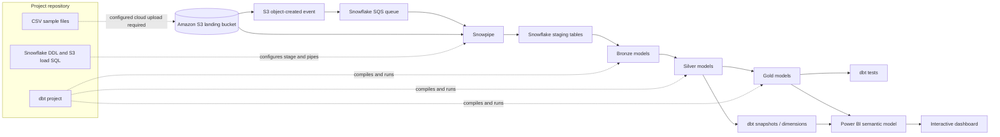
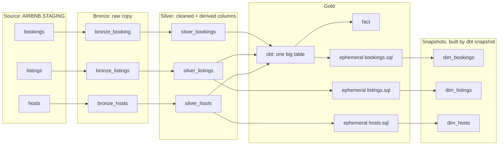
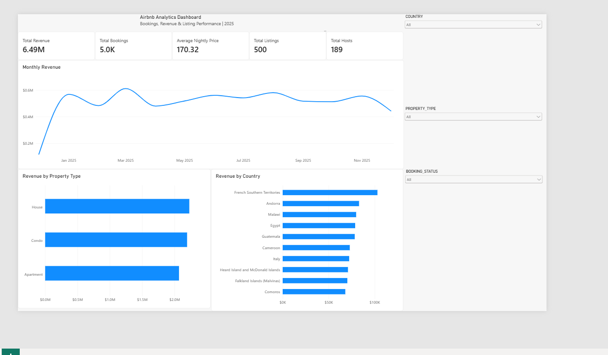
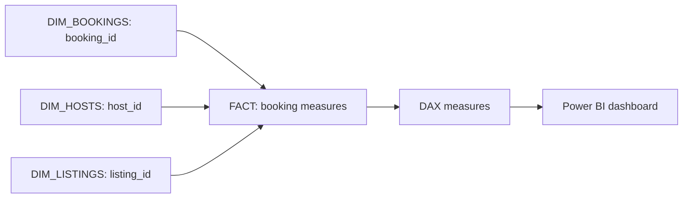
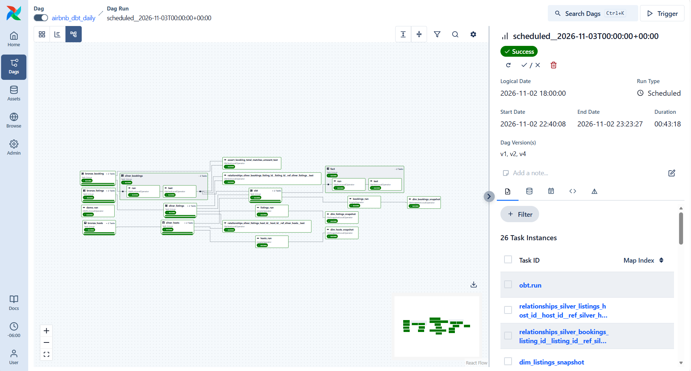

# Airbnb Data Platform

An Airbnb-style analytics engineering project built with Snowflake, dbt, and Power BI. It models bookings, hosts, and listings through a medallion-style warehouse, with incremental transformations, snapshots, data quality checks, and an interactive dashboard.

The platform combines S3 and Snowpipe ingestion with dbt transformations, snapshots, data quality tests, GitHub Actions CI, Terraform definitions, a local Airflow/Cosmos DAG, and a Power BI report. Source CSVs are uploaded to S3 manually; Airflow schedules dbt independently of Snowpipe.

## At a glance

| Area | Current implementation |
|---|---|
| Data domains | Bookings, hosts, listings |
| Warehouse | Snowflake |
| Transformation | dbt Core with Snowflake adapter |
| Modeling approach | Bronze, silver, and gold layers |
| History | Timestamp-based dbt snapshots |
| Data quality | dbt test, including a warning-level custom check |
| Cloud ingestion | S3 bucket, storage integration (IAM role), stage, and Snowpipe auto-ingest via S3 event notifications and SQS |
| Orchestration | Apache Airflow with Cosmos: daily dbt DAG with retries and a failure alert (local Docker setup) |
| Infrastructure as code | Terraform definitions for the S3 bucket, IAM role, Snowflake storage integration, and warehouses |
| Continuous integration | GitHub Actions PR checks and manual builds against `AIRBNB_CI` |
| Analytics | Power BI Desktop report built on Gold facts and dimensions |

## System architecture

### Current project flow



The repository includes sample CSVs, Snowflake load definitions, dbt models and tests, and a Power BI report. Snowpipe loads matching new files after they are uploaded to S3; uploading files and triggering dbt after a load are separate steps. The SQL does not contain AWS access keys.

The `snowpipe-source` S3 notification sends object-created events to Snowflake's SQS queue. Three Snowpipe pipes load matching CSV files into staging, using a storage integration and an IAM role for bucket access. The Power BI report consumes the Gold fact and dimensions.

## Data flow

1. **Prepare source data.** The repository includes CSV examples for bookings, hosts, and listings under `sourceData/`.
2. **Land files.** Upload source files to the S3 landing location.
3. **Load Snowflake staging.** `DDL/resources.sql` creates the storage integration, file format, external stage, and one Snowpipe per table. New CSVs in `source/` load automatically. It needs the IAM role, trust policy, and S3 event notification described under Security and deployment notes.
4. **Declare dbt sources.** `models/sources/sources.yml` maps the Snowflake staging tables to dbt source names.
5. **Build bronze models.** Bronze models select from the staging sources and use a `CREATED_AT` watermark for incremental runs.
6. **Transform silver models.** Silver models standardize fields and add derived business attributes.
7. **Publish gold models.** Gold models combine booking, listing, and host attributes for analytical use.
8. **Track changes.** dbt snapshots retain historical versions of selected models.
9. **Validate outputs.** Run dbt tests and inspect warnings or failures before consumers use the models.
10. **Analyze in Power BI.** Import the Gold fact and dimensions into the report's semantic model and explore the dashboard.

## Data domains

### Bookings

Reservation-level activity used for booking and revenue analysis. The sample data includes booking identifiers, listing references, dates, nights booked, amounts, fees, booking status, and creation timestamps.

### Hosts

Host attributes used to describe supply ownership and service performance. The data includes host identifiers, names, join dates, superhost status, response rates, and creation timestamps.

### Listings

Property inventory and pricing attributes used to analyze supply and accommodation mix. The data includes listing and host identifiers, property and room types, location, capacity, bedrooms, bathrooms, nightly price, and creation timestamps.

## Warehouse layers

| Layer | Purpose | Examples in this project |
|---|---|---|
| Source / staging | Raw Snowflake tables exposed to dbt | `staging.bookings`, `staging.hosts`, `staging.listings` |
| Bronze | Lightly transformed source-shaped data | `bronze_booking`, `bronze_hosts`, `bronze_listings` |
| Silver | Cleaned and enriched entities | `silver_bookings`, `silver_hosts`, `silver_listings` |
| Gold | Consumer-facing joins and analytical outputs | `obt` and other gold models |
| Snapshots | Historical versions of changing records | Booking, host, and listing snapshots |

### Bronze

Bronze models read from declared dbt sources and retain the source data with limited transformation. Incremental logic filters for records whose `CREATED_AT` value is later than the current model's maximum timestamp.

This is a simple watermark pattern suitable for demonstrating incremental dbt processing. Before production use, it should be reviewed for late-arriving records, updates to existing records, timestamp ties, and source-side deletes. A configurable lookback window, merge strategy, or ingestion timestamp may be needed depending on source behavior.

### Silver

The silver layer applies business-oriented cleanup and enrichment:

- **Bookings:** exposes `booking_amount` as `total_amount` and retains booking-level attributes.
- **Hosts:** standardizes host text and classifies response rates into readable tags.
- **Listings:** carries listing, capacity, location, and price attributes and derives a price category.

Silver models are incremental and use `unique_key` to match incoming records to the current entity row:

| Model | `unique_key` | What the key identifies |
|---|---|---|
| `silver_bookings` | `booking_id` | One booking |
| `silver_listings` | `LISTING_ID` | One listing |
| `silver_hosts` | `HOST_ID` | One host |

The key is specific to each model. `HOST_ID` can appear on many rows in `silver_listings` because one host may own multiple listings; `LISTING_ID` is the listing model's key. `unique_key` tells dbt how to match rows for incremental updates. It does not itself test or enforce uniqueness; add dbt `unique` tests for that.

### Gold

The gold layer combines silver entities for easier analysis. The operational base table joins bookings to listings and then listings to hosts, making reservation, property, and host attributes available together.

The `obt.sql` model uses Jinja configuration to generate column selections and joins.

### Model lineage



- `fact` selects keys and measures directly from `obt`. Unused dimension joins were removed to prevent row multiplication; listing and host IDs remain available for reporting relationships.
- The ephemeral host and listing models read from `silver_hosts` and `silver_listings`, respectively, so each snapshot input has entity-level grain. The ephemeral bookings model still reads from `obt`. Ephemeral models create no tables.
- The `dim_*` tables are snapshots built from the ephemeral models. Development snapshots use `AIRBNB.GOLD`; CI snapshots use the CI target database and prefixed gold schema.

## Model grains and business rules

Column-level descriptions live in `aws_snowflake_project/models/schema.yml`.

| Model | One row represents | Key |
|---|---|---|
| `bronze_booking`, `silver_bookings` | One booking | `booking_id` |
| `bronze_listings`, `silver_listings` | One listing | `listing_id` |
| `bronze_hosts`, `silver_hosts` | One host | `host_id` |
| `obt`, `fact` | One booking with listing and host attributes | `booking_id` |
| `dim_listings`, `dim_hosts`, `dim_bookings` (snapshots, `gold` schema) | One version of a listing, host or booking (SCD Type 2) | Entity ID plus validity range |

**Booking totals.** `booking_amount` is the full-stay price: across the 5,000 sample bookings, `booking_amount / (nights_booked * price_per_night)` has a median of 1.02. `silver_bookings.total_amount` is therefore `booking_amount`, excluding `cleaning_fee` and `service_fee`, which are reported separately. It previously multiplied by `nights_booked`, which overstated revenue; run `dbt build --full-refresh --select silver_bookings+` to rebuild existing rows, because the incremental filter will not rewrite them.

**Cancellations.** Cancelled bookings stay in every layer and are identified by `booking_status`. Revenue and booking-count metrics should exclude `cancelled` rows unless a metric states otherwise.

**Timestamps.** `booking_date` is the booking's date and drives time-based reporting. `created_at` is the load timestamp and the incremental watermark only; it is not a business date.

**Known limitations (confirmed in Snowflake).**

- **Silver duplicate-key issue addressed.** Silver models now configure `unique_key` and incremental filters. After a full refresh, the three Silver keys passed their uniqueness tests. The filters use a strict `CREATED_AT > MAX(CREATED_AT)` watermark, so tied timestamps and late-arriving or updated rows may still be missed.
- **Gold validation and snapshot rebuild.** CI passed the fact booking-ID uniqueness test. During BI integration, the development snapshot tables were reported backed up, rebuilt, and validated as described below; ongoing snapshot-history correctness still requires testing.

## Historical tracking

The project contains timestamp-strategy snapshots for bookings, hosts, and listings. A unique key identifies each entity, while its creation/update timestamp is used as the snapshot's `updated_at` input.

Snapshots preserve prior versions when the tracked row changes. In a production design, confirm that the selected timestamp changes whenever tracked attributes change. If `CREATED_AT` is immutable after insertion, it will not detect later updates; use a genuine `UPDATED_AT` column or consider dbt's check strategy.

## Power BI Analytics Dashboard



Power BI executive dashboard built on the Snowflake Gold star schema, providing revenue, booking, pricing, listing, host, property-type, geographic, and interactive filtering analysis. The [Power BI Desktop report](PowerBI/Airbnb_Dashboards.pbix) uses the Snowflake connector with key-pair authentication and Import mode, according to the report implementation notes.

The dashboard displays Total Revenue, Total Bookings, Average Nightly Price, Total Listings, and Total Hosts alongside monthly revenue, revenue by property type, and the top 10 countries by revenue. Country and property-type slicers use listing attributes; booking status comes from the booking dimension. Slicers filter the fact-based visuals through the semantic model's relationships.

The screenshot shows approximately 6.49M in revenue, 5.0K bookings, 170.32 average nightly price, 500 listings, and 189 hosts represented in the fact data. These are values from this sample dataset and report state, not Airbnb-wide metrics. `Average Nightly Price` is averaged over fact rows, so listings with more bookings have more weight. The displayed revenue measure does not itself exclude cancelled bookings; use the booking-status slicer or define a separate filtered measure when cancellation-adjusted revenue is needed.

### Semantic Model

The report uses `FACT` as its central table and `DIM_BOOKINGS`, `DIM_HOSTS`, and `DIM_LISTINGS` as dimensions. The reported relationships are one-to-many from each dimension's business key to the corresponding key in `FACT`; `OBT` is an upstream dbt model rather than the report's primary table. Dimensions are dbt snapshots, so when genuine history accumulates, a business key may have multiple versions. A current-row filter or version-aware relationship is needed before using such keys on the one side of a relationship.



The report's core measures, as supplied in the implementation notes, are:

```dax
Total Revenue = SUM(FACT[TOTAL_AMOUNT])
Total Bookings = DISTINCTCOUNT(FACT[BOOKING_ID])
Average Nightly Price = AVERAGE(FACT[PRICE_PER_NIGHT])
Total Listings = DISTINCTCOUNT(FACT[LISTING_ID])
Total Hosts = DISTINCTCOUNT(FACT[HOST_ID])
```

## Snapshot Data Quality

During Power BI integration, duplicate dimension keys prevented clean one-to-many relationships. Instead of hiding the duplicates in Power Query, the investigation checked Bronze and Silver keys, reviewed the ephemeral host model, and traced the issue to physical rows in the Gold snapshots. For hosts, the source and Silver keys were reported unique, and the ephemeral `hosts` model selects from `silver_hosts` without a join.

The reported Snowflake validation results were:

| Snapshot | Before: total rows | Before: distinct business keys / SCD IDs | After: rows / keys / SCD IDs |
|---|---:|---:|---:|
| `DIM_HOSTS` | 240,011 | 200 / 200 | 200 / 200 / 200 |
| `DIM_BOOKINGS` | 75,000 | 5,000 / 5,000 | 5,000 / 5,000 / 5,000 |
| `DIM_LISTINGS` | 240,000 | 500 / 500 | 500 / 500 / 500 |

Repeated physical rows with the same `DBT_SCD_ID` are not distinct snapshot versions. Before rebuilding, the existing transient snapshot tables were backed up with transient zero-copy clones; the snapshots were then dropped, recreated with `dbt snapshot`, checked for row and key counts, and refreshed in Power BI. The backups preserve the previous tables; rebuilding from current input does not reconstruct their history. The exact cause of the duplicates has not been established, and the counts alone do not prove future history will remain correct.

This keeps the Gold data-quality correction upstream in Snowflake/dbt, rather than masking the issue in Power Query. The Power BI implementation and remediation counts above are based on the supplied project notes; the `.pbix` binary model and live Snowflake state were not independently inspected in this documentation update.

## Reusable dbt logic

The macros folder contains examples of shared SQL/Jinja logic:

| Macro | Intended use |
|---|---|
| `multiply.sql` | Calculate a rounded product for derived numeric values |
| `tag.sql` | Convert a numeric value into a readable category |
| `trimmer.sql` | Demonstrate text normalization using Jinja filters |
| `generate_schema_name.sql` | Customize dbt's target schema naming behavior |

Macros reduce repeated expressions when their behavior is genuinely shared. They should remain small, explicit, and covered by model-level tests where possible.

## Data quality and validation

The project includes dbt schema tests in `aws_snowflake_project/models/schema.yml`:

- `not_null` checks for bronze booking, listing, and host IDs
- `unique` checks for bronze booking, listing, and host IDs
- `not_null` and `unique` checks for silver booking, listing, and host keys
- Relationship checks from bookings to listings and listings to hosts
- An accepted-values check restricting booking status to `confirmed` or `cancelled`
- `not_null` checks for booking status and listing host IDs

Two singular SQL tests in `aws_snowflake_project/tests/` check numeric rules: `assert_booking_numeric_rules.sql` returns bookings with non-positive nights or negative amounts/fees, and `assert_host_response_rate_range.sql` returns hosts with response rates outside 0–100. dbt discovers these files when `dbt test` runs; no model needs to call them. A singular test passes when its query returns zero rows. If it returns violating rows, dbt marks the test as failed and reports the failure count; it does not modify or remove the data. Run the query directly or enable failure storage to inspect the offending rows.

It also includes a custom warning-level test against source bookings. It flags rows with a `booking_amount` below the configured threshold. The warning severity allows the run to complete while surfacing records for review.

Validation results:

- `uv run dbt test --select bronze_booking bronze_hosts bronze_listings silver_bookings silver_listings silver_hosts --profiles-dir .` completed successfully: all 29 selected tests passed with no warnings or errors.
- Run a single singular SQL test by name, for example: `uv run dbt test --select assert_booking_numeric_rules --profiles-dir .`.
- A full refresh build (`dbt build --full-refresh`) against data reloaded from S3 completed with `PASS=46 WARN=1 ERROR=0 SKIP=0 TOTAL=47`. These are build-node outcomes, not 47 data tests; the build ran the data tests alongside models and snapshots, including the booking-total check.
- The warning came from `source_tests`: 286 source bookings had `booking_amount < 200`. Its configured warning severity allowed the build to succeed.
- Passing current-data tests does not establish incremental rerun, late-arrival, update, or snapshot-history correctness.

## Repository layout

```text
airbnb-enterprise-data-platform/
├── README.md
├── .github/workflows/dbt-ci.yml    # PR and manual CI workflow
├── main.py                         # Minimal Python entry point
├── pyproject.toml                  # Python and dbt dependencies
├── DDL/
│   ├── ddl.sql                     # Snowflake raw table definitions
│   └── resources.sql               # Storage integration, stage, and Snowpipe pipes
├── sourceData/
│   ├── bookings.csv
│   ├── hosts.csv
│   └── listings.csv
├── terraform/
│   ├── main.tf                     # S3, IAM role, storage integration, warehouses, imports
│   ├── variables.tf
│   └── terraform.tfvars.example    # Placeholder values; copy to terraform.tfvars (git-ignored)
├── airflow/
│   ├── Dockerfile                  # Airflow image with dbt in its own virtualenv
│   ├── docker-compose.yml          # Single-container local Airflow
│   ├── requirements.txt            # astronomer-cosmos
│   ├── .env.example                # Placeholder values; copy to .env (git-ignored)
│   └── dags/
│       ├── airbnb_dbt_dag.py       # Cosmos DbtDag: retries, daily schedule, failure callback
│       └── alerts.py               # Failure alert callback
└── aws_snowflake_project/
    ├── dbt_project.yml
    ├── profiles.yml                # Local dbt connection configuration
    ├── ci/profiles.yml             # Committed environment-based CI profile
    ├── macros/
    ├── models/
    │   ├── bronze/
    │   ├── silver/
    │   ├── gold/
    │   └── sources/
    ├── snapshots/
    └── tests/
```

Generated dbt artifacts such as `target/`, package downloads, and logs may appear locally. They are build/runtime outputs rather than source architecture components.

## Technology

- **Snowflake:** cloud data warehouse and SQL execution engine.
- **dbt Core:** transformation project, dependency graph, snapshots, and tests.
- **dbt-snowflake:** adapter connecting dbt to Snowflake.
- **SQL and Jinja:** transformation logic and reusable model generation.
- **Python and uv:** project environment and dependency management.
- **Amazon S3:** object-storage landing area; new CSVs in `source/` trigger Snowpipe through S3 event notifications.
- **Power BI Desktop:** imported Gold semantic model, DAX measures, and interactive dashboard.
- **Terraform:** infrastructure as code for the S3 bucket, IAM role, Snowflake storage integration, and warehouses (providers `hashicorp/aws` and `snowflakedb/snowflake`).
- **Apache Airflow and Cosmos:** orchestration; Cosmos renders each dbt model and its tests as Airflow tasks.

## Local setup

### Prerequisites

- Python 3.12 or newer
- `uv`
- Access to a Snowflake account and the required database/schema privileges
- A configured dbt profile for the project

### Install dependencies

From the repository root:

```powershell
uv sync
```

### Validate and run dbt

From the dbt project directory:

```powershell
cd aws_snowflake_project
uv run dbt debug --profiles-dir .
uv run dbt run --profiles-dir .
uv run dbt test --profiles-dir .
uv run dbt snapshot --profiles-dir .
```

`--profiles-dir .` tells dbt to read `profiles.yml` from the current directory (`aws_snowflake_project`). The `.` is a relative path meaning "here". Run these commands from the dbt project directory. To run only the Silver data tests, use `uv run dbt test --select silver_bookings silver_listings silver_hosts --profiles-dir .`.

The Snowflake account, warehouse, role, database, schema, and authentication values must match your environment. Do not commit real passwords, private keys, or cloud access keys.

### SQL linting

Install the Git hook and run the SQLFluff baseline from the repository root:

```powershell
uvx pre-commit install
uvx pre-commit run --all-files
```

SQLFluff uses the Snowflake dialect and Jinja's dbt built-ins. The initial `AM06` rule checks consistent `GROUP BY` and `ORDER BY` references; this narrow baseline is not a full SQL style or dbt compilation check.

## GitHub Actions CI

The workflow in [.github/workflows/dbt-ci.yml](.github/workflows/dbt-ci.yml) runs SQLFluff on pull requests and the **Build and test dbt** job for pull requests from branches in this repository. It also supports manual runs through `workflow_dispatch`. Fork PRs skip the credentialed job. The manual-run control becomes available when the workflow is present on the default branch.

The job installs Python 3.12 and `uv`, runs `uv sync --locked`, checks the Snowflake connection, and executes `dbt build`. This builds models and snapshots and runs their tests in dependency order. The private key is written to a restricted temporary runner file and removed in an always-run cleanup step; it is not stored in the repository.

### Authentication and isolation

The profile in [aws_snowflake_project/ci/profiles.yml](aws_snowflake_project/ci/profiles.yml) reads environment variables supplied by the workflow. Configure these repository secrets under **Settings > Secrets and variables > Actions**:

| Secret | Purpose |
|---|---|
| `SNOWFLAKE_ACCOUNT` | Snowflake account identifier |
| `SNOWFLAKE_USER` | Dedicated service user, `DBT_CI_USER` |
| `SNOWFLAKE_ROLE` | Restricted CI role, `DBT_CI_ROLE` |
| `SNOWFLAKE_WAREHOUSE` | Warehouse used for CI queries |
| `SNOWFLAKE_DATABASE` | Must be `AIRBNB_CI`; the workflow rejects other values |
| `SNOWFLAKE_PRIVATE_KEY` | Entire encrypted private-key PEM, including BEGIN/END lines and line breaks |
| `SNOWFLAKE_PRIVATE_KEY_PASSPHRASE` | Passphrase protecting that private key |

Register only the matching public key with the Snowflake service user. A public-key file or fingerprint cannot substitute for the private-key secret. The CI role has read access to the three `AIRBNB.STAGING` source tables, warehouse usage, and permission to create schemas in `AIRBNB_CI`; it does not need `ACCOUNTADMIN`.

PR 7 uses schema names such as `CI_PR_7_bronze`, `CI_PR_7_silver`, and `CI_PR_7_gold`. Manual runs use a prefix based on the workflow run ID. `ref()` resolves model destinations automatically, and the schema macro prefixes layer schemas only for the `ci` target. Development naming is unchanged. Runs sharing a PR schema are serialized.

From the repository root, with CI environment variables and a private-key file configured locally, the equivalent commands are:

```powershell
uv run dbt debug --project-dir aws_snowflake_project --profiles-dir aws_snowflake_project/ci --target ci
uv run dbt build --project-dir aws_snowflake_project --profiles-dir aws_snowflake_project/ci --target ci
```

The development profile remains ignored by Git; the credential-free `ci/profiles.yml` has an explicit ignore-rule exception so GitHub receives it. Never put literal secrets into the CI profile. Rotate any exposed development credentials and assess Git history separately.

### Verified build result

The GitHub Actions build completed with `PASS=45 WARN=1 ERROR=0 SKIP=0 TOTAL=46`. The warning came from the intentional source-booking amount check. Warning-level data tests do not block a successful job.

### dbt docs on GitHub Pages

The [dbt docs workflow](.github/workflows/dbt-docs.yml) generates a static site on pushes to `main` and on manual runs from `main`. In **Settings > Pages**, choose **GitHub Actions** as the build and deployment source, then run the workflow or merge it to `main`. The deployment job provides the published URL.

Generation uses a placeholder-only profile and an empty catalog, so it does not connect to Snowflake or require credentials. The site includes project lineage and descriptions but omits live warehouse catalog metadata and compiled SQL. GitHub Pages is public for this repository: review the generated manifest, including model names and project metadata, before publishing.

To generate the same files locally from the repository root:

```powershell
uv run dbt docs generate --project-dir aws_snowflake_project --profiles-dir .github/dbt-docs --target docs --no-compile --empty-catalog
```

## Infrastructure as code (Terraform)

The `terraform/` folder defines the cloud and Snowflake objects the load path depends on: the S3 bucket and its public-access block, the Snowflake storage integration `S3_AIRBNB_INT`, the IAM role `snowflake_s3_role` with its read policy, and the Snowflake warehouses. `import` blocks adopt the objects that already exist, so the first apply should change nothing.

The Terraform configuration defines the bucket, role, integration, and warehouses. The stage and pipes are defined in `DDL/resources.sql`; the S3 event notification is configured in the AWS console.

**Circular dependency.** The integration needs the role ARN, and the role's trust policy needs the integration's IAM user ARN and external ID. The configuration builds the role ARN as a string from the account ID and role name, so the integration does not depend on the role resource, and the trust policy reads Snowflake's values from the integration's `describe_output`.

**Requirements**

- Terraform 1.5 or newer (the `import` blocks need it).
- AWS credentials that can manage IAM and S3.
- A Snowflake user that can use `ACCOUNTADMIN` and has an RSA public key registered.

**Run**

```powershell
cd terraform
Copy-Item terraform.tfvars.example terraform.tfvars   # then fill in organization, account, and user
$env:SNOWFLAKE_PRIVATE_KEY = Get-Content <path-to-key.p8> -Raw
$env:SNOWFLAKE_PRIVATE_KEY_PASSPHRASE = '<passphrase>'
terraform init
terraform plan
```

Review the plan before applying. If it proposes replacing the storage integration, stop: a new integration issues a new external ID and breaks the role's trust policy until the apply completes. Match the `warehouses` variable to the output of `SHOW WAREHOUSES` so the plan shows no warehouse changes.

**Secrets.** State files record sensitive values in plaintext, so `*.tfstate`, `.terraform/`, `terraform.tfvars`, and private keys (`*.p8`, `*.pem`) are git-ignored. Provide the Snowflake private key and passphrase only through environment variables. Consider a remote, encrypted backend before sharing this configuration.

## Orchestration with Airflow and Cosmos

The `airflow/` folder runs the dbt project as an Apache Airflow DAG using [Astronomer Cosmos](https://astronomer.github.io/astronomer-cosmos/). Cosmos reads the dbt project and renders each model, snapshot, and its tests as Airflow tasks, so the DAG graph mirrors the dbt lineage.

**DAG `airbnb_dbt_daily`** (`airflow/dags/airbnb_dbt_dag.py`)

| Setting | Value |
|---|---|
| Schedule | `@daily`, `catchup=False`, one active run at a time |
| Retries | 2 per task, 5 minute delay, exponential backoff capped at 30 minutes |
| Failure alert | `on_failure_callback` in `airflow/dags/alerts.py`; runs after retries are exhausted, logs the failure, and posts to `AIRFLOW_ALERT_WEBHOOK_URL` (Slack-compatible, https only) when set |
| Tests | Each model's tests run immediately after it (`TestBehavior.AFTER_EACH`); tests that span several models (for example the booking total check and the bookings-to-listings relationship) run as separate tasks after all of their parent models (`should_detach_multiple_parents_tests=True`) |
| Profile | The credential-free `aws_snowflake_project/ci/profiles.yml`, so no secrets live in the DAG or image |
| Target | Database `AIRBNB_CI`, schemas `AIRFLOW_BRONZE`, `AIRFLOW_SILVER`, `AIRFLOW_GOLD`, kept separate from CI and development |

dbt is installed in its own virtualenv inside the image so its dependencies cannot conflict with Airflow's, and Cosmos runs it as a subprocess (`InvocationMode.SUBPROCESS`) for both parsing and execution. The Snowflake private key is mounted read-only from the host and is never copied into the image.

**Task layout.** Each model that has tests is a task group with a `run` task followed by a `test` task (for example `silver_bookings.run`, `silver_bookings.test`). Models without tests are a single `<model>_run` task, snapshots are `<snapshot>_snapshot` tasks, and ephemeral models render as empty tasks that preserve the dependency chain. All of a model's tests are bundled into its one `test` task, so the DAG has far fewer tasks than dbt has nodes.

**Run locally** (requires Docker Desktop)

1. **Create your settings file.** From the repository root:

   ```powershell
   cd airflow
   Copy-Item .env.example .env
   ```

   Edit `airflow/.env` (never `.env.example`, which is committed) and set the Snowflake account, user, role, warehouse, database `AIRBNB_CI`, the key passphrase `SNOWFLAKE_PRIVATE_KEY_PASSPHRASE`, and `SNOWFLAKE_PRIVATE_KEY_FILE`, the full path to your private key using forward slashes (for example `C:/Users/<you>/.snowflake/dbt_ci_private.p8`). Leave `DBT_CI_SCHEMA=AIRFLOW`. Set `AIRFLOW_ALERT_WEBHOOK_URL` only if you want alert messages.

2. **Start Docker Desktop** and wait until it reports the engine is running.

3. **Build and start Airflow.** From the `airflow` folder:

   ```powershell
   docker compose up --build
   ```

   The first build downloads the Airflow image and installs dbt and Cosmos. Leave this window open; it shows the logs.

4. **Get the login password.** Airflow generates one for the user `admin` each time the container is created. In a second terminal, in the `airflow` folder:

   ```powershell
   docker compose logs --no-color airflow | Select-String -Pattern "password" -CaseSensitive:$false | Select-Object -First 5
   ```

   If the line has scrolled out of the logs, read it from the file Airflow saves:

   ```powershell
   docker compose exec airflow cat /opt/airflow/simple_auth_manager_passwords.json.generated
   ```

5. **Open the UI** at http://127.0.0.1:8080 and sign in as `admin` with that password.

6. **Run the DAG.** Find `airbnb_dbt_daily` (it can take a minute to appear while Cosmos reads the dbt project), switch it on, then use **Trigger**. Open the **Graph** view to watch tasks, and click a task and choose **Logs** to see the dbt output.

7. **Stop.** `docker compose down` stops the container and keeps Airflow's history; `docker compose restart airflow` restarts it and keeps the same password. A new container (after `down` and `up`) gets a new password.

Unpausing the DAG makes Airflow create the most recent missed daily run immediately, so a scheduled run may start before your manual trigger; with one active run allowed, the manual run waits in the queue.

To see the failure alert fire, set `AIRFLOW_ALERT_WEBHOOK_URL` in `.env`, break a model, and trigger the DAG.

**Example run.** A successful scheduled run of `airbnb_dbt_daily`: all 26 tasks succeeded, with the models and their tests grouped as `run` and `test` tasks, the three cross-model tests as standalone tasks, and the snapshots at the end.



**Behind a TLS-inspecting proxy.** On networks that re-sign HTTPS traffic (for example Zscaler), the image build and the running container need the proxy's root certificate. Export it as a PEM file with a `.crt` extension into `airflow/certs/`; the Dockerfile adds it to the image's trust store. These files are git-ignored. If Docker itself cannot pull images, enabling WSL mirrored networking (`networkingMode=mirrored` in `%USERPROFILE%\.wslconfig`) can help.

The local Airflow setup uses a single container, SQLite and `airflow standalone`, with a maximum of two concurrent tasks. Airflow metadata is stored in a Docker volume, and `airflow/.env` is git-ignored.

## Security and deployment notes

`DDL/resources.sql` loads source data without AWS keys. A Snowflake storage integration (`s3_airbnb_int`) assumes the IAM role `snowflake_s3_role`, whose policy allows only `s3:GetObject` and `s3:ListBucket` on `s3://snowbucketyoussef/source/`. The role's trust policy accepts only the Snowflake IAM user and external ID returned by `DESC INTEGRATION s3_airbnb_int`. The role ARN and bucket path are identifiers, not secrets. Never commit access keys, `.env` files, or the integration's external ID. Do not recreate the integration with `CREATE OR REPLACE`, because that issues a new external ID and breaks the trust policy.

For a cloud deployment:

- Prefer a Snowflake storage integration with an AWS IAM role over long-lived AWS keys in SQL.
- Scope the role to the required S3 bucket and prefixes only.
- Store Snowflake authentication in a secret manager or CI/CD secret store.
- Separate development and production roles, databases, schemas, and warehouses.
- Apply encryption, retention, and access policies to source files and warehouse data.
- Keep generated dbt artifacts and local secrets out of Git using appropriate ignore rules.
- Audit access and define a rotation/revocation process for credentials.

## Design considerations

### Incremental processing

The bronze models use `CREATED_AT` as a high-water mark. This is easy to understand and avoids scanning all source rows on each run. It assumes source records arrive in timestamp order and that rows are append-only. Real feeds may violate those assumptions, so a production implementation should define its late-arrival, duplicate, update, and delete policies explicitly.

### File ingestion

`DDL/resources.sql` defines a storage integration, file format, external stage, and one auto-ingest pipe per table. S3 sends `ObjectCreated` events for `source/*.csv` to the pipes' SQS queue, and each pipe loads files whose names match its table. Pipes load only files that arrive after creation and skip names they have already loaded, so use a new file name for every upload. Backfill older files with a manual `COPY INTO`. Never use `CREATE OR REPLACE PIPE`, which resets load history. The SQL does not create the S3 bucket, IAM role, or event notification, upload local files, run dbt after a load, or handle rejected-file remediation.

### Orchestration

GitHub Actions runs dbt for PR validation and manual CI builds. The local Airflow DAG schedules dbt runs and provides retries and an optional webhook failure alert.

### Analytics contract

The Gold layer supplies the fact and dimensions used by the Power BI semantic model. The dashboard measures and their interpretation are documented in the Power BI section.

## System walkthrough

The end-to-end design follows this sequence:

1. Source files provide booking, host, and listing records.
2. Snowflake staging tables expose the loaded data to dbt sources.
3. Bronze models retain source-shaped records and apply incremental filtering.
4. Silver models standardize fields and derive business attributes.
5. Gold models join the entities into analytics-ready outputs.
6. Snapshots retain historical versions, while dbt tests check selected data quality rules.
7. Power BI imports the Gold fact and dimensions for interactive analysis.

The project uses sample Airbnb-style datasets; it is not a live Airbnb integration.
