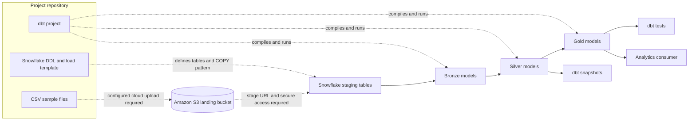
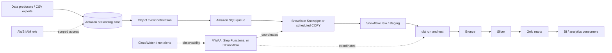
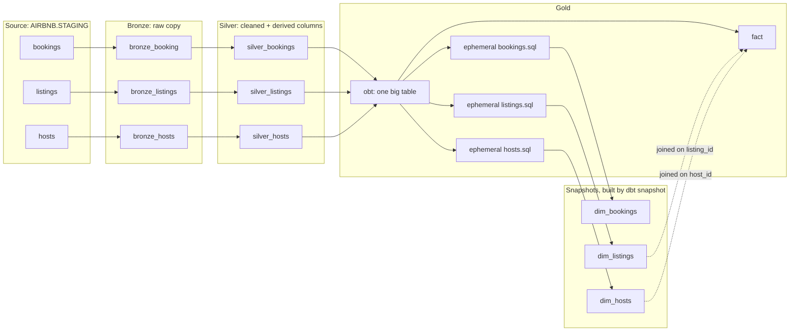

# Airbnb Enterprise Data Platform

An Airbnb-style analytics engineering project built with Snowflake and dbt. It models bookings, hosts, and listings through a medallion-style warehouse, with reusable SQL macros, incremental models, snapshots, and data quality checks.

> **Implementation status:** the dbt warehouse models and local CSV datasets are present. The Snowflake S3 stage and `COPY INTO` load pattern is represented in `DDL/resources.sql`; its bucket URL, target table, file name, and AWS credentials are intentionally replaced with placeholders in this repository copy for security. Restore real values from secure configuration before running it. Automated file delivery, orchestration, CI/CD, and dashboards are not described here as deployed components.

## At a glance

| Area | Current implementation |
|---|---|
| Data domains | Bookings, hosts, listings |
| Warehouse | Snowflake |
| Transformation | dbt Core with Snowflake adapter |
| Modeling approach | Bronze, silver, and gold layers |
| History | Timestamp-based dbt snapshots |
| Data quality | dbt test, including a warning-level custom check |
| Cloud ingestion | Snowflake stage/COPY load pattern; sensitive/account-specific values redacted in the SQL copy |
| Orchestration | Not implemented |

## System architecture

### Current project flow



The repository currently contains the CSVs, Snowflake table definitions, dbt models, snapshots, macros, and tests. The dotted connections identify setup or deployment steps that still need to be supplied; they are not evidence of an automated AWS pipeline. Values in the checked-in S3 load SQL are placeholders substituted for security and must be supplied securely to execute that script.

### AWS-oriented reference architecture

The following is a production direction for the project, not a claim that these AWS services have already been provisioned.



Possible AWS components and their responsibilities:

| Component | Proposed responsibility | Project status |
|---|---|---|
| Amazon S3 | Store source files in a durable landing area | S3 stage/COPY load pattern is documented; bucket details are redacted in the SQL copy |
| S3 prefixes | Separate landing, processed, and rejected files | Design recommendation |
| S3 event notifications + SQS | Buffer file-arrival events and avoid losing bursts | Not implemented |
| Snowflake storage integration | Grant Snowflake scoped access to S3 without embedding long-lived AWS keys | Recommended security option; configuration is not shown in this repository |
| Snowpipe or scheduled `COPY INTO` | Load new files into Snowflake staging | `COPY INTO` load pattern is present; identifiers and credentials are redacted, and automated triggering is not implemented here |
| dbt Core | Build warehouse transformations and run tests | Implemented locally |
| GitHub Actions or dbt Cloud | Validate and deploy dbt changes | Not implemented |
| MWAA or Step Functions | Coordinate multi-step ingestion and transformation | Optional future choice; not selected |
| CloudWatch and alerting | Monitor AWS-side failures and notify operators | Not implemented |
| BI tool | Explore curated gold-layer datasets | Not included |

The reference design intentionally leaves orchestration as a decision. For a small project, a scheduled GitHub Actions workflow or dbt Cloud job may be enough. MWAA is more appropriate when the platform needs richer DAG dependencies, retries, backfills, and operational controls.

## Data flow

1. **Prepare source data.** The repository includes CSV examples for bookings, hosts, and listings under `sourceData/`.
2. **Land files.** In a cloud deployment, upload source files to an S3 landing location. This upload step is not automated in the current project.
3. **Load Snowflake staging.** The SQL in `DDL/resources.sql` demonstrates a file format, external stage, and `COPY INTO` pattern. Replace the placeholders and configure secure access before running it.
4. **Declare dbt sources.** `models/sources/sources.yml` maps the Snowflake staging tables to dbt source names.
5. **Build bronze models.** Bronze models select from the staging sources and use a `CREATED_AT` watermark for incremental runs.
6. **Transform silver models.** Silver models standardize fields and add derived business attributes.
7. **Publish gold models.** Gold models combine booking, listing, and host attributes for analytical use.
8. **Track changes.** dbt snapshots retain historical versions of selected models.
9. **Validate outputs.** Run dbt tests and inspect warnings or failures before consumers use the models.

## Data domains

### Bookings

Reservation-level activity used for booking and revenue analysis. The sample data includes booking identifiers, listing references, dates, nights booked, amounts, fees, booking status, and creation timestamps.

### Hosts

Host attributes used to describe supply ownership and service performance. The data includes host identifiers, names, join dates, superhost status, response rates, and creation timestamps.

### Listings

Property inventory and pricing attributes used to analyze supply and accommodation mix. The data includes listing and host identifiers, property and room types, location, capacity, bedrooms, bathrooms, nightly price, and creation timestamps.

## Warehouse layers

| Layer | Purpose | Examples in this project |
|---|---|---|
| Source / staging | Raw Snowflake tables exposed to dbt | `staging.bookings`, `staging.hosts`, `staging.listings` |
| Bronze | Lightly transformed source-shaped data | `bronze_booking`, `bronze_hosts`, `bronze_listings` |
| Silver | Cleaned and enriched entities | `silver_bookings`, `silver_hosts`, `silver_listings` |
| Gold | Consumer-facing joins and analytical outputs | `obt` and other gold models |
| Snapshots | Historical versions of changing records | Booking, host, and listing snapshots |

### Bronze

Bronze models read from declared dbt sources and retain the source data with limited transformation. Incremental logic filters for records whose `CREATED_AT` value is later than the current model's maximum timestamp.

This is a simple watermark pattern suitable for demonstrating incremental dbt processing. Before production use, it should be reviewed for late-arriving records, updates to existing records, timestamp ties, and source-side deletes. A configurable lookback window, merge strategy, or ingestion timestamp may be needed depending on source behavior.

### Silver

The silver layer applies business-oriented cleanup and enrichment:

- **Bookings:** derives booking totals through a reusable multiplication macro and retains booking-level attributes.
- **Hosts:** standardizes host text and classifies response rates into readable tags.
- **Listings:** carries listing, capacity, location, and price attributes and derives a price category.

### Gold

The gold layer combines silver entities for easier analysis. The operational base table joins bookings to listings and then listings to hosts, making reservation, property, and host attributes available together.

The `obt.sql` model uses Jinja configuration to generate column selections and joins. This demonstrates dbt macro/Jinja capabilities; as the project grows, model-specific SQL or tested macros may be easier to maintain than a highly generic query generator.

### Model lineage



- `fact` selects keys and measures from `obt`. Its joins to `dim_listings` and `dim_hosts` select no dimension columns.
- The ephemeral models in `models/gold/ephemeral/` choose each dimension's columns from `obt`. They create no tables.
- The `dim_*` tables are dbt snapshots in `AIRBNB.GOLD`, created by `dbt snapshot` from the ephemeral models.

## Model grains and business rules

Column-level descriptions live in `aws_snowflake_project/models/schema.yml`.

| Model | One row represents | Key |
|---|---|---|
| `bronze_booking`, `silver_bookings` | One booking | `booking_id` |
| `bronze_listings`, `silver_listings` | One listing | `listing_id` |
| `bronze_hosts`, `silver_hosts` | One host | `host_id` |
| `obt`, `fact` | One booking with listing and host attributes | `booking_id` |
| `dim_listings`, `dim_hosts`, `dim_bookings` (snapshots, `gold` schema) | One version of a listing, host or booking (SCD Type 2) | Entity ID plus validity range |

**Booking totals.** `total_amount` is `nights_booked * booking_amount`, rounded to 2 decimals. It excludes `cleaning_fee` and `service_fee`, which are reported separately. Open question: the sample `booking_amount` values look like full-stay prices, so confirm whether this multiplication is intended before building revenue metrics.

**Cancellations.** Cancelled bookings stay in every layer and are identified by `booking_status`. Revenue and booking-count metrics should exclude `cancelled` rows unless a metric states otherwise.

**Timestamps.** `booking_date` is the booking's date and drives time-based reporting. `created_at` is the load timestamp and the incremental watermark only; it is not a business date.

**Known limitation.** The silver models set `keys=` in their config, which dbt does not treat as a unique key (the setting is `unique_key`). Until that is changed, a re-delivered row is appended rather than merged, so the one-row-per-key grain is not enforced.

## Historical tracking

The project contains timestamp-strategy snapshots for bookings, hosts, and listings. A unique key identifies each entity, while its creation/update timestamp is used as the snapshot's `updated_at` input.

Snapshots preserve prior versions when the tracked row changes. In a production design, confirm that the selected timestamp changes whenever tracked attributes change. If `CREATED_AT` is immutable after insertion, it will not detect later updates; use a genuine `UPDATED_AT` column or consider dbt's check strategy.

## Reusable dbt logic

The macros folder contains examples of shared SQL/Jinja logic:

| Macro | Intended use |
|---|---|
| `multiply.sql` | Calculate a rounded product for derived numeric values |
| `tag.sql` | Convert a numeric value into a readable category |
| `trimmer.sql` | Demonstrate text normalization using Jinja filters |
| `generate_schema_name.sql` | Customize dbt's target schema naming behavior |

Macros reduce repeated expressions when their behavior is genuinely shared. They should remain small, explicit, and covered by model-level tests where possible.

## Data quality and validation

The project includes a custom warning-level test against source bookings. It flags rows with a `booking_amount` below the configured threshold. The warning severity allows the run to complete while surfacing records for review.

Current local validation:

- `dbt test` completed with exit code `0` in the current environment.
- The run reported one warning from the intentional warning-level check.
- A successful test command verifies dbt execution, but does not by itself prove that every business rule or production scenario is covered.

Recommended additions as the model matures:

- `not_null` and `unique` tests for entity keys
- relationship tests for booking-to-listing and listing-to-host references
- accepted-value tests for booking statuses and boolean-like fields
- source freshness thresholds once source loading is automated
- reconciliation checks for source and target row counts or financial totals
- tests for incremental reruns, late-arriving records, and changed source rows

## Repository layout

```text
airbnb-enterprise-data-platform/
├── README.md
├── main.py                         # Minimal Python entry point
├── pyproject.toml                  # Python and dbt dependencies
├── DDL/
│   ├── ddl.sql                     # Snowflake raw table definitions
│   └── resources.sql               # Stage and COPY INTO template
├── sourceData/
│   ├── bookings.csv
│   ├── hosts.csv
│   └── listings.csv
└── aws_snowflake_project/
    ├── dbt_project.yml
    ├── profiles.yml                # Local dbt connection configuration
    ├── macros/
    ├── models/
    │   ├── bronze/
    │   ├── silver/
    │   ├── gold/
    │   └── sources/
    ├── snapshots/
    └── tests/
```

Generated dbt artifacts such as `target/`, package downloads, and logs may appear locally. They are build/runtime outputs rather than source architecture components.

## Technology

- **Snowflake:** cloud data warehouse and SQL execution engine.
- **dbt Core:** transformation project, dependency graph, snapshots, and tests.
- **dbt-snowflake:** adapter connecting dbt to Snowflake.
- **SQL and Jinja:** transformation logic and reusable model generation.
- **Python and uv:** project environment and dependency management.
- **Amazon S3:** intended object-storage landing area for a future automated ingestion path.

## Local setup

### Prerequisites

- Python 3.12 or newer
- `uv`
- Access to a Snowflake account and the required database/schema privileges
- A configured dbt profile for the project

### Install dependencies

From the repository root:

```powershell
uv sync
```

### Validate and run dbt

From the dbt project directory:

```powershell
cd aws_snowflake_project
uv run dbt debug --profiles-dir .
uv run dbt run --profiles-dir .
uv run dbt test --profiles-dir .
uv run dbt snapshot --profiles-dir .
```

The Snowflake account, warehouse, role, database, schema, and authentication values must match your environment. Do not commit real passwords, private keys, or cloud access keys.

## Security and deployment notes

The checked-in `DDL/resources.sql` copy has its S3 URL, target table, file name, and AWS credentials replaced with placeholders for security. Those placeholders are redactions, not the values to run with; supply the actual configuration securely. Do not commit working credentials. For production, prefer a Snowflake storage integration with an AWS IAM role over embedding long-lived AWS keys in SQL.

For a cloud deployment:

- Prefer a Snowflake storage integration with an AWS IAM role over long-lived AWS keys in SQL.
- Scope the role to the required S3 bucket and prefixes only.
- Store Snowflake authentication in a secret manager or CI/CD secret store.
- Separate development and production roles, databases, schemas, and warehouses.
- Apply encryption, retention, and access policies to source files and warehouse data.
- Keep generated dbt artifacts and local secrets out of Git using appropriate ignore rules.
- Audit access and define a rotation/revocation process for credentials.

## Design considerations

### Incremental processing

The bronze models use `CREATED_AT` as a high-water mark. This is easy to understand and avoids scanning all source rows on each run. It assumes source records arrive in timestamp order and that rows are append-only. Real feeds may violate those assumptions, so a production implementation should define its late-arrival, duplicate, update, and delete policies explicitly.

### File ingestion

`DDL/resources.sql` defines a Snowflake file format and external stage, then uses `COPY INTO` to load a named file from S3 into a target table. The checked-in copy has security-sensitive and environment-specific values replaced with placeholders, so it must be populated from secure configuration before execution. This SQL does not create an S3 bucket, upload local files, monitor arrivals, schedule loads, or handle rejected-file remediation.

### Orchestration

dbt commands can be run locally, but the repository does not currently schedule or coordinate them. A future workflow should define ordering, retries, failure notifications, backfills, and whether tests block downstream publication.

### Analytics contract

The gold layer is an analytical starting point rather than a fully governed semantic layer. Metric definitions, grain, ownership, freshness expectations, and consumer-facing documentation should be agreed before adding dashboards or external consumers.

## Roadmap

1. **Automate ingestion:** create the S3 landing bucket, Snowflake storage integration, and repeatable file-loading workflow.
2. **Harden configuration:** remove credential placeholders and configure environment-specific secrets and permissions.
3. **Strengthen models and tests:** define model grains, key constraints, relationship checks, freshness, and incremental edge-case coverage.
4. **Add orchestration and CI:** run dbt validation on changes and schedule controlled deployments with clear failure alerts.
5. **Publish analytics:** define trusted business metrics and connect a dashboard or other consumer to selected gold models.

## System walkthrough

The end-to-end design follows this sequence:

1. Source files provide booking, host, and listing records.
2. Snowflake staging tables expose the loaded data to dbt sources.
3. Bronze models retain source-shaped records and apply incremental filtering.
4. Silver models standardize fields and derive business attributes.
5. Gold models join the entities into analytics-ready outputs.
6. Snapshots retain historical versions, while dbt tests check selected data quality rules.
7. The AWS reference architecture describes a future path to automated file delivery, loading, orchestration, and monitoring.

## Scope and limitations

This repository demonstrates dbt transformations and warehouse design using sample Airbnb-style datasets. It is not a live Airbnb integration and does not currently provide automated cloud ingestion, a deployed AWS environment, production orchestration, CI/CD, or a dashboard.

That scope keeps the implementation honest and makes the next engineering steps explicit: automate secure file ingestion, define operational guarantees, expand test coverage, and publish governed analytical outputs.
