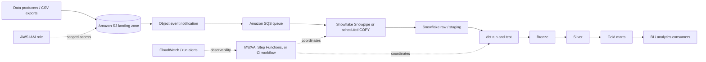
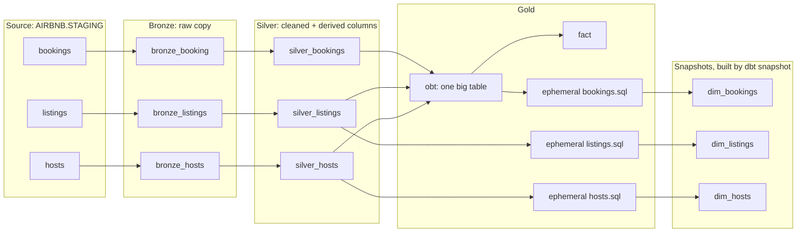

# Airbnb Enterprise Data Platform

An Airbnb-style analytics engineering project built with Snowflake and dbt. It models bookings, hosts, and listings through a medallion-style warehouse, with reusable SQL macros, incremental models, snapshots, and data quality checks.

> **Implementation status:** dbt models, snapshots, tests, and GitHub Actions CI are implemented. CI builds and tests against an isolated Snowflake database using key-pair authentication and GitHub Secrets. Source data loads from S3 into Snowflake through a storage integration, a stage, and `COPY INTO` in `DDL/resources.sql`; no AWS keys are used. Automated file delivery, scheduled production orchestration, continuous deployment, and dashboards are not implemented.

## At a glance

| Area | Current implementation |
|---|---|
| Data domains | Bookings, hosts, listings |
| Warehouse | Snowflake |
| Transformation | dbt Core with Snowflake adapter |
| Modeling approach | Bronze, silver, and gold layers |
| History | Timestamp-based dbt snapshots |
| Data quality | dbt test, including a warning-level custom check |
| Cloud ingestion | S3 bucket, Snowflake storage integration (IAM role), stage, and manual `COPY INTO` |
| Orchestration | Not implemented |
| Continuous integration | GitHub Actions PR checks and manual builds against `AIRBNB_CI` |

## System architecture

### Current project flow


The repository currently contains the CSVs, Snowflake table definitions, dbt models, snapshots, macros, and tests. The dotted connections identify setup or deployment steps that still need to be supplied; they are not evidence of an automated AWS pipeline. The S3 load is run manually from `DDL/resources.sql`, which contains no credentials.

### AWS-oriented reference architecture

The following is a production direction for the project, not a claim that these AWS services have already been provisioned.



Possible AWS components and their responsibilities:

| Component | Proposed responsibility | Project status |
|---|---|---|
| Amazon S3 | Store source files in a durable landing area | Implemented: bucket `snowbucketyoussef`, source files under `source/` |
| S3 prefixes | Separate landing, processed, and rejected files | Design recommendation |
| S3 event notifications + SQS | Buffer file-arrival events and avoid losing bursts | Not implemented |
| Snowflake storage integration | Grant Snowflake scoped access to S3 without embedding long-lived AWS keys | Implemented: `s3_airbnb_int` assumes IAM role `snowflake_s3_role`, limited to read access on `source/` |
| Snowpipe or scheduled `COPY INTO` | Load new files into Snowflake staging | Manual `COPY INTO` implemented; Snowpipe and automated triggering are not implemented |
| dbt Core | Build warehouse transformations and run tests | Implemented locally |
| GitHub Actions | Validate dbt changes | PR and manual CI builds implemented |
| MWAA or Step Functions | Coordinate multi-step ingestion and transformation | Optional future choice; not selected |
| CloudWatch and alerting | Monitor AWS-side failures and notify operators | Not implemented |
| BI tool | Explore curated gold-layer datasets | Not included |

The reference design intentionally leaves orchestration as a decision. For a small project, a scheduled GitHub Actions workflow or dbt Cloud job may be enough. MWAA is more appropriate when the platform needs richer DAG dependencies, retries, backfills, and operational controls.

## Data flow

1. **Prepare source data.** The repository includes CSV examples for bookings, hosts, and listings under `sourceData/`.
2. **Land files.** In a cloud deployment, upload source files to an S3 landing location. This upload step is not automated in the current project.
3. **Load Snowflake staging.** `DDL/resources.sql` creates the storage integration, file format, and external stage, then loads each CSV with `COPY INTO`. It needs the IAM role and trust policy described under Security and deployment notes.
4. **Declare dbt sources.** `models/sources/sources.yml` maps the Snowflake staging tables to dbt source names.
5. **Build bronze models.** Bronze models select from the staging sources and use a `CREATED_AT` watermark for incremental runs.
6. **Transform silver models.** Silver models standardize fields and add derived business attributes.
7. **Publish gold models.** Gold models combine booking, listing, and host attributes for analytical use.
8. **Track changes.** dbt snapshots retain historical versions of selected models.
9. **Validate outputs.** Run dbt tests and inspect warnings or failures before consumers use the models.

## Data domains

### Bookings

Reservation-level activity used for booking and revenue analysis. The sample data includes booking identifiers, listing references, dates, nights booked, amounts, fees, booking status, and creation timestamps.

### Hosts

Host attributes used to describe supply ownership and service performance. The data includes host identifiers, names, join dates, superhost status, response rates, and creation timestamps.

### Listings

Property inventory and pricing attributes used to analyze supply and accommodation mix. The data includes listing and host identifiers, property and room types, location, capacity, bedrooms, bathrooms, nightly price, and creation timestamps.

## Warehouse layers

| Layer | Purpose | Examples in this project |
|---|---|---|
| Source / staging | Raw Snowflake tables exposed to dbt | `staging.bookings`, `staging.hosts`, `staging.listings` |
| Bronze | Lightly transformed source-shaped data | `bronze_booking`, `bronze_hosts`, `bronze_listings` |
| Silver | Cleaned and enriched entities | `silver_bookings`, `silver_hosts`, `silver_listings` |
| Gold | Consumer-facing joins and analytical outputs | `obt` and other gold models |
| Snapshots | Historical versions of changing records | Booking, host, and listing snapshots |

### Bronze

Bronze models read from declared dbt sources and retain the source data with limited transformation. Incremental logic filters for records whose `CREATED_AT` value is later than the current model's maximum timestamp.

This is a simple watermark pattern suitable for demonstrating incremental dbt processing. Before production use, it should be reviewed for late-arriving records, updates to existing records, timestamp ties, and source-side deletes. A configurable lookback window, merge strategy, or ingestion timestamp may be needed depending on source behavior.

### Silver

The silver layer applies business-oriented cleanup and enrichment:

- **Bookings:** exposes `booking_amount` as `total_amount` and retains booking-level attributes.
- **Hosts:** standardizes host text and classifies response rates into readable tags.
- **Listings:** carries listing, capacity, location, and price attributes and derives a price category.

Silver models are incremental and use `unique_key` to match incoming records to the current entity row:

| Model | `unique_key` | What the key identifies |
|---|---|---|
| `silver_bookings` | `booking_id` | One booking |
| `silver_listings` | `LISTING_ID` | One listing |
| `silver_hosts` | `HOST_ID` | One host |

The key is specific to each model. `HOST_ID` can appear on many rows in `silver_listings` because one host may own multiple listings; `LISTING_ID` is the listing model's key. `unique_key` tells dbt how to match rows for incremental updates. It does not itself test or enforce uniqueness; add dbt `unique` tests for that.

### Gold

The gold layer combines silver entities for easier analysis. The operational base table joins bookings to listings and then listings to hosts, making reservation, property, and host attributes available together.

The `obt.sql` model uses Jinja configuration to generate column selections and joins. This demonstrates dbt macro/Jinja capabilities; as the project grows, model-specific SQL or tested macros may be easier to maintain than a highly generic query generator.

### Model lineage



- `fact` selects keys and measures directly from `obt`. Unused dimension joins were removed to prevent row multiplication; listing and host IDs remain available for reporting relationships.
- The ephemeral host and listing models read from `silver_hosts` and `silver_listings`, respectively, so each snapshot input has entity-level grain. The ephemeral bookings model still reads from `obt`. Ephemeral models create no tables.
- The `dim_*` tables are snapshots built from the ephemeral models. Development snapshots use `AIRBNB.GOLD`; CI snapshots use the CI target database and prefixed gold schema.

## Model grains and business rules

Column-level descriptions live in `aws_snowflake_project/models/schema.yml`.

| Model | One row represents | Key |
|---|---|---|
| `bronze_booking`, `silver_bookings` | One booking | `booking_id` |
| `bronze_listings`, `silver_listings` | One listing | `listing_id` |
| `bronze_hosts`, `silver_hosts` | One host | `host_id` |
| `obt`, `fact` | One booking with listing and host attributes | `booking_id` |
| `dim_listings`, `dim_hosts`, `dim_bookings` (snapshots, `gold` schema) | One version of a listing, host or booking (SCD Type 2) | Entity ID plus validity range |

**Booking totals.** `booking_amount` is the full-stay price: across the 5,000 sample bookings, `booking_amount / (nights_booked * price_per_night)` has a median of 1.02. `silver_bookings.total_amount` is therefore `booking_amount`, excluding `cleaning_fee` and `service_fee`, which are reported separately. It previously multiplied by `nights_booked`, which overstated revenue; run `dbt build --full-refresh --select silver_bookings+` to rebuild existing rows, because the incremental filter will not rewrite them.

**Cancellations.** Cancelled bookings stay in every layer and are identified by `booking_status`. Revenue and booking-count metrics should exclude `cancelled` rows unless a metric states otherwise.

**Timestamps.** `booking_date` is the booking's date and drives time-based reporting. `created_at` is the load timestamp and the incremental watermark only; it is not a business date.

**Known limitations (confirmed in Snowflake).**

- **Silver duplicate-key issue addressed.** Silver models now configure `unique_key` and incremental filters. After a full refresh, the three Silver keys passed their uniqueness tests. The filters use a strict `CREATED_AT > MAX(CREATED_AT)` watermark, so tied timestamps and late-arriving or updated rows may still be missed.
- **CI gold validation completed.** A build in a fresh CI schema passed the fact booking-ID uniqueness test after correcting dimension inputs and removing unused fact joins. This does not establish that older development tables or previously duplicated snapshots have been repaired; they need separate validation and a deliberate migration or cleanup.

## Historical tracking

The project contains timestamp-strategy snapshots for bookings, hosts, and listings. A unique key identifies each entity, while its creation/update timestamp is used as the snapshot's `updated_at` input.

Snapshots preserve prior versions when the tracked row changes. In a production design, confirm that the selected timestamp changes whenever tracked attributes change. If `CREATED_AT` is immutable after insertion, it will not detect later updates; use a genuine `UPDATED_AT` column or consider dbt's check strategy.

## Reusable dbt logic

The macros folder contains examples of shared SQL/Jinja logic:

| Macro | Intended use |
|---|---|
| `multiply.sql` | Calculate a rounded product for derived numeric values |
| `tag.sql` | Convert a numeric value into a readable category |
| `trimmer.sql` | Demonstrate text normalization using Jinja filters |
| `generate_schema_name.sql` | Customize dbt's target schema naming behavior |

Macros reduce repeated expressions when their behavior is genuinely shared. They should remain small, explicit, and covered by model-level tests where possible.

## Data quality and validation

The project includes dbt schema tests in `aws_snowflake_project/models/schema.yml`:

- `not_null` checks for bronze booking, listing, and host IDs
- `unique` checks for bronze booking, listing, and host IDs
- `not_null` and `unique` checks for silver booking, listing, and host keys
- Relationship checks from bookings to listings and listings to hosts
- An accepted-values check restricting booking status to `confirmed` or `cancelled`
- `not_null` checks for booking status and listing host IDs

Two singular SQL tests in `aws_snowflake_project/tests/` check numeric rules: `assert_booking_numeric_rules.sql` returns bookings with non-positive nights or negative amounts/fees, and `assert_host_response_rate_range.sql` returns hosts with response rates outside 0–100. dbt discovers these files when `dbt test` runs; no model needs to call them. A singular test passes when its query returns zero rows. If it returns violating rows, dbt marks the test as failed and reports the failure count; it does not modify or remove the data. Run the query directly or enable failure storage to inspect the offending rows.

It also includes a custom warning-level test against source bookings. It flags rows with a `booking_amount` below the configured threshold. The warning severity allows the run to complete while surfacing records for review.

Validation results:

- `uv run dbt test --select bronze_booking bronze_hosts bronze_listings silver_bookings silver_listings silver_hosts --profiles-dir .` completed successfully: all 29 selected tests passed with no warnings or errors.
- Run a single singular SQL test by name, for example: `uv run dbt test --select assert_booking_numeric_rules --profiles-dir .`.
- A full refresh build (`dbt build --full-refresh`) against data reloaded from S3 completed with `PASS=46 WARN=1 ERROR=0 SKIP=0 TOTAL=47`. These are build-node outcomes, not 47 data tests; the build ran the data tests alongside models and snapshots, including the booking-total check.
- The warning came from `source_tests`: 286 source bookings had `booking_amount < 200`. Its configured warning severity allowed the build to succeed.
- Passing current-data tests does not establish incremental rerun, late-arrival, update, or snapshot-history correctness.

Recommended additions as the model matures:

- source freshness thresholds once source loading is automated
- reconciliation checks for source and target row counts or financial totals
- tests for incremental reruns, late-arriving records, and changed source rows

## Repository layout

```text
airbnb-enterprise-data-platform/
├── README.md
├── .github/workflows/dbt-ci.yml    # PR and manual CI workflow
├── main.py                         # Minimal Python entry point
├── pyproject.toml                  # Python and dbt dependencies
├── DDL/
│   ├── ddl.sql                     # Snowflake raw table definitions
│   └── resources.sql               # Storage integration, stage, and COPY INTO
├── sourceData/
│   ├── bookings.csv
│   ├── hosts.csv
│   └── listings.csv
└── aws_snowflake_project/
    ├── dbt_project.yml
    ├── profiles.yml                # Local dbt connection configuration
    ├── ci/profiles.yml             # Committed environment-based CI profile
    ├── macros/
    ├── models/
    │   ├── bronze/
    │   ├── silver/
    │   ├── gold/
    │   └── sources/
    ├── snapshots/
    └── tests/
```

Generated dbt artifacts such as `target/`, package downloads, and logs may appear locally. They are build/runtime outputs rather than source architecture components.

## Technology

- **Snowflake:** cloud data warehouse and SQL execution engine.
- **dbt Core:** transformation project, dependency graph, snapshots, and tests.
- **dbt-snowflake:** adapter connecting dbt to Snowflake.
- **SQL and Jinja:** transformation logic and reusable model generation.
- **Python and uv:** project environment and dependency management.
- **Amazon S3:** intended object-storage landing area for a future automated ingestion path.

## Local setup

### Prerequisites

- Python 3.12 or newer
- `uv`
- Access to a Snowflake account and the required database/schema privileges
- A configured dbt profile for the project

### Install dependencies

From the repository root:

```powershell
uv sync
```

### Validate and run dbt

From the dbt project directory:

```powershell
cd aws_snowflake_project
uv run dbt debug --profiles-dir .
uv run dbt run --profiles-dir .
uv run dbt test --profiles-dir .
uv run dbt snapshot --profiles-dir .
```

`--profiles-dir .` tells dbt to read `profiles.yml` from the current directory (`aws_snowflake_project`). The `.` is a relative path meaning "here". Run these commands from the dbt project directory. To run only the Silver data tests, use `uv run dbt test --select silver_bookings silver_listings silver_hosts --profiles-dir .`.

The Snowflake account, warehouse, role, database, schema, and authentication values must match your environment. Do not commit real passwords, private keys, or cloud access keys.

## GitHub Actions CI

The workflow in [.github/workflows/dbt-ci.yml](.github/workflows/dbt-ci.yml) runs the **Build and test dbt** job for pull requests from branches in this repository and supports manual runs through `workflow_dispatch`. Fork PRs skip the credentialed job. The manual-run control becomes available when the workflow is present on the default branch.

The job installs Python 3.12 and `uv`, runs `uv sync --locked`, checks the Snowflake connection, and executes `dbt build`. This builds models and snapshots and runs their tests in dependency order. The private key is written to a restricted temporary runner file and removed in an always-run cleanup step; it is not stored in the repository.

### Authentication and isolation

The profile in [aws_snowflake_project/ci/profiles.yml](aws_snowflake_project/ci/profiles.yml) reads environment variables supplied by the workflow. Configure these repository secrets under **Settings > Secrets and variables > Actions**:

| Secret | Purpose |
|---|---|
| `SNOWFLAKE_ACCOUNT` | Snowflake account identifier |
| `SNOWFLAKE_USER` | Dedicated service user, `DBT_CI_USER` |
| `SNOWFLAKE_ROLE` | Restricted CI role, `DBT_CI_ROLE` |
| `SNOWFLAKE_WAREHOUSE` | Warehouse used for CI queries |
| `SNOWFLAKE_DATABASE` | Must be `AIRBNB_CI`; the workflow rejects other values |
| `SNOWFLAKE_PRIVATE_KEY` | Entire encrypted private-key PEM, including BEGIN/END lines and line breaks |
| `SNOWFLAKE_PRIVATE_KEY_PASSPHRASE` | Passphrase protecting that private key |

Register only the matching public key with the Snowflake service user. A public-key file or fingerprint cannot substitute for the private-key secret. The CI role has read access to the three `AIRBNB.STAGING` source tables, warehouse usage, and permission to create schemas in `AIRBNB_CI`; it does not need `ACCOUNTADMIN`.

PR 7 uses schema names such as `CI_PR_7_bronze`, `CI_PR_7_silver`, and `CI_PR_7_gold`. Manual runs use a prefix based on the workflow run ID. `ref()` resolves model destinations automatically, and the schema macro prefixes layer schemas only for the `ci` target. Development naming is unchanged. Runs sharing a PR schema are serialized.

From the repository root, with CI environment variables and a private-key file configured locally, the equivalent commands are:

```powershell
uv run dbt debug --project-dir aws_snowflake_project --profiles-dir aws_snowflake_project/ci --target ci
uv run dbt build --project-dir aws_snowflake_project --profiles-dir aws_snowflake_project/ci --target ci
```

The development profile remains ignored by Git; the credential-free `ci/profiles.yml` has an explicit ignore-rule exception so GitHub receives it. Never put literal secrets into the CI profile. Rotate any exposed development credentials and assess Git history separately.

### Verified build result

The GitHub Actions build completed with `PASS=45 WARN=1 ERROR=0 SKIP=0 TOTAL=46`. The warning came from the intentional source-booking amount check. Warning-level data tests do not block a successful job.

## Security and deployment notes

`DDL/resources.sql` loads source data without AWS keys. A Snowflake storage integration (`s3_airbnb_int`) assumes the IAM role `snowflake_s3_role`, whose policy allows only `s3:GetObject` and `s3:ListBucket` on `s3://snowbucketyoussef/source/`. The role's trust policy accepts only the Snowflake IAM user and external ID returned by `DESC INTEGRATION s3_airbnb_int`. The role ARN and bucket path are identifiers, not secrets. Never commit access keys, `.env` files, or the integration's external ID. Do not recreate the integration with `CREATE OR REPLACE`, because that issues a new external ID and breaks the trust policy.

For a cloud deployment:

- Prefer a Snowflake storage integration with an AWS IAM role over long-lived AWS keys in SQL.
- Scope the role to the required S3 bucket and prefixes only.
- Store Snowflake authentication in a secret manager or CI/CD secret store.
- Separate development and production roles, databases, schemas, and warehouses.
- Apply encryption, retention, and access policies to source files and warehouse data.
- Keep generated dbt artifacts and local secrets out of Git using appropriate ignore rules.
- Audit access and define a rotation/revocation process for credentials.

## Design considerations

### Incremental processing

The bronze models use `CREATED_AT` as a high-water mark. This is easy to understand and avoids scanning all source rows on each run. It assumes source records arrive in timestamp order and that rows are append-only. Real feeds may violate those assumptions, so a production implementation should define its late-arrival, duplicate, update, and delete policies explicitly.

### File ingestion

`DDL/resources.sql` defines a storage integration, file format, and external stage, then uses `COPY INTO` to load each named CSV from S3 into its staging table. `COPY INTO` skips files it has already loaded, so run `TRUNCATE TABLE` on the target first to reload. The SQL does not create the S3 bucket or IAM role, upload local files, monitor arrivals, schedule loads, or handle rejected-file remediation.

### Orchestration

GitHub Actions runs dbt for PR validation and manual CI builds. It is not a scheduled production data orchestrator. Production scheduling, retries, failure notifications, backfills, and downstream publication gates remain future work.

### Analytics contract

The gold layer is an analytical starting point rather than a fully governed semantic layer. Metric definitions, grain, ownership, freshness expectations, and consumer-facing documentation should be agreed before adding dashboards or external consumers.

## Roadmap

1. **Automate ingestion:** S3 bucket, storage integration, and manual `COPY INTO` are implemented; add S3 event notifications with Snowpipe so new files load automatically.
2. **Harden configuration:** replace broad S3 permissions on the CLI user with a bucket-scoped policy, and rotate any previously exposed keys.
3. **Strengthen models and tests:** define model grains, key constraints, relationship checks, freshness, and incremental edge-case coverage.
4. **Extend CI and add orchestration:** CI builds are implemented; verify merge protection, add optional daily validation and CI-schema cleanup, and design controlled deployments with failure alerts.
5. **Publish analytics:** define trusted business metrics and connect a dashboard or other consumer to selected gold models.

## System walkthrough

The end-to-end design follows this sequence:

1. Source files provide booking, host, and listing records.
2. Snowflake staging tables expose the loaded data to dbt sources.
3. Bronze models retain source-shaped records and apply incremental filtering.
4. Silver models standardize fields and derive business attributes.
5. Gold models join the entities into analytics-ready outputs.
6. Snapshots retain historical versions, while dbt tests check selected data quality rules.
7. The AWS reference architecture describes a future path to automated file delivery, loading, orchestration, and monitoring.

## Scope and limitations

This repository demonstrates dbt transformations, warehouse design, and GitHub Actions CI using sample Airbnb-style datasets. It is not a live Airbnb integration and does not currently provide automated cloud ingestion, a deployed AWS environment, production orchestration, continuous deployment, or a dashboard.

That scope keeps the implementation honest and makes the next engineering steps explicit: automate secure file ingestion, define operational guarantees, expand test coverage, and publish governed analytical outputs.
